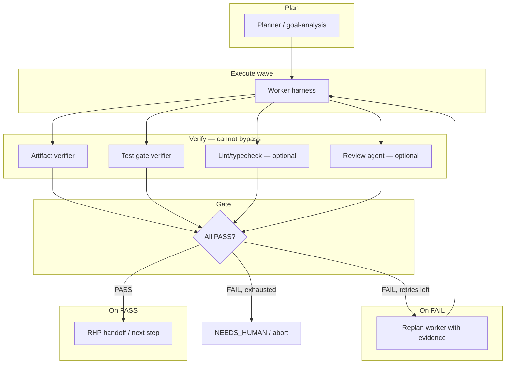

# Relay Build Handoff: Strong Verifiers + Task Graph + Harness Engineering

> **Handoff document for Codex (or any builder agent)**  
> **Reference this file as:** `docs/codex-build-handoff-verifiers-and-graph.md`  
> **Repo:** `/Users/shaynavinoth/Projects/relay`  
> **Last updated:** 2026-07-09  
> **Companion docs:** [production-ready-roadmap.md](./production-ready-roadmap.md) · [thin-router.md](./thin-router.md) · [strategic-handoff-plan.md](./strategic-handoff-plan.md)

---

## Table of contents

1. [Executive summary](#1-executive-summary)
2. [Vision and positioning](#2-vision-and-positioning)
3. [Current state (what exists today)](#3-current-state-what-exists-today)
4. [The problem we are solving](#4-the-problem-we-are-solving)
5. [Design sources (what to inherit)](#5-design-sources-what-to-inherit)
6. [Target architecture](#6-target-architecture)
7. [Implementation phases (V0 → V4)](#7-implementation-phases-v0--v4)
8. [Sprint alignment with production roadmap](#8-sprint-alignment-with-production-roadmap)
9. [File map and touch points](#9-file-map-and-touch-points)
10. [Event schema and observability](#10-event-schema-and-observability)
11. [Testing and acceptance criteria](#11-testing-and-acceptance-criteria)
12. [Constraints and non-goals](#12-constraints-and-non-goals)
13. [Risk register](#13-risk-register)
14. [Suggested build order (week-by-week)](#14-suggested-build-order-week-by-week)
15. [Codex prompt (copy-paste)](#15-codex-prompt-copy-paste)

---

## 1. Executive summary

Relay is a **local multi-agent mesh orchestrator** (Claude Code, Codex, Cursor, Pi) with sessions, handoffs (RHP), blended routing, and a `relay chat` TUI.

**What makes Relay more than “run Claude Code directly”:**

| Claude Code alone | Relay + verifiers + graph |
|-------------------|---------------------------|
| Internal loop, opaque pass/fail | Explicit verify graph in `relay trace` |
| One model self-checks | Separate verifier contexts (harder to fool) |
| Sequential review in one thread | Parallel test + review nodes |
| No session-level evidence graph | `.relay/verify/` + typed outcomes |
| No cross-agent gate | Worker (Pi) → verify → only then handoff to Codex |

**This handoff covers three intertwined workstreams:**

1. **Strong verifiers** — verify before you act (AgentOracle patterns, implemented natively)
2. **Task graph executor** — parallel reviewer diamond + verify-fail loops (Flowtivity / Strands / graph-engineering)
3. **Harness engineering** — file-based evidence, read-only evaluators, observability (Lil’Log / AHE / Self-Harness)

**Success metric for v0.1:** micro-bench **3/3** on `jobs/mini-bench/host-micro/` after verifier wiring + trivial fast path.

---

## 2. Vision and positioning

### North star

> A real team can clone `main`, run `relay chat` on a real repo, trust routing and handoffs, and pass a 15-item production checklist — without Pro LLM planner, cloud sync, or Harbor CI.

### OSS positioning (honest)

- **Relay wins on multi-step workflows** — plan → implement → verify → review → handoff — not every one-liner vs `claude -p`.
- **“Any agent, any LLM, any model” must stay.** Fast path skips **overhead and bad hops**, not Pi or handoffs as features.
- **Tier 3 LLM planner is out of scope for v0.1 RC.** Routing uses Tier 1 (rules/preflight) + Tier 2 (blend/cost); no routing LLM tokens today.

### v0.2 differentiation (this handoff)

Build the layer that Claude Code cannot easily replicate as a single harness:

```
Planner → Worker → [parallel Verifiers] → Synthesizer → Pass/Fail gate → loop (max N)
                              ↓
                    .relay/verify/ evidence on disk
                              ↓
                    verify-fail → replan worker (not just log)
```

---

## 3. Current state (what exists today)

### Repo health (as of 2026-07-09)

| Metric | Value |
|--------|-------|
| Uncommitted files | ~100 (Sprints 0–3 mostly local) |
| Tests | ~404+ green locally |
| Micro-bench | Relay **1/3** (Claude/Codex **3/3**) |
| Last pushed commit | `0efc970` (Pi × Relay fusion baseline) |

### What is already built (Sprints 1–3, local)

| Area | Status | Notes |
|------|--------|-------|
| Auth preflight | ✅ | `harness-eligibility.ts`, plan/execute preflight |
| Tiered handoffs | ✅ | `rhp-builder.ts`, ~158 tokens trivial implement |
| Trivial goal planning | ✅ | `isTrivialGoal()` → 1 step |
| Cost blend | ✅ | `costUsd` → `routing-stats.jsonl` |
| Hybrid routing | ✅ | 60/30/10, trace, doctor, confidence filter |
| Live E2E scaffold | 🟡 | `RELAY_LIVE_E2E=1` |
| Failover model leak fix | ✅ | `execute-plan.ts` + `replan.ts` — **not re-benchmarked** |

### What is weak or missing (this handoff’s focus)

| Gap | Current behavior | Target behavior |
|-----|------------------|-----------------|
| Per-step verification | Wave-level git + optional test gate only | Per-step artifact + task verifiers before handoff |
| Verify-fail → replan | Skips next wave or marks error; no worker retry loop | Retry worker with structured feedback (max 3) |
| Claim audit | None | SUPPORTED / REFUTED / UNVERIFIABLE per claim |
| Parallel verifiers | None | artifact + test + lint in parallel |
| Graph executor | Linear waves in `execute-plan.ts` | Conditional edges, reviewer diamond behind `RELAY_GRAPH=1` |
| Trivial fast path | Full mesh preamble on every hop | Skip handoff overhead on 1-of-1 trivial steps |

### Current verify implementation (Pattern 0)

Location: `packages/orchestrator/src/verify.ts`

```typescript
// Today:
// 1. listChangedFiles (git status --porcelain)
// 2. optional runTestGate (pnpm test or RELAY_VERIFY_TEST_COMMAND)
// Called between waves (wave > 0), NOT per-step with task-specific checks
```

Location: `packages/orchestrator/src/execute-plan.ts` (lines ~501–517)

- If verify fails between waves → skip remaining steps, return `{ ok: false }`
- **Does not** retry the worker with verifier feedback
- **Does not** run task-specific checks (hello.sh output, fib(10)==55, etc.)

### Current replan (failover only)

Location: `packages/orchestrator/src/replan.ts`

- One failover retry to alternate harness (auth/capability/runtime failure)
- `failoverReason`: `"auth" | "capability" | "verify" | "none"`
- **No** verify-fail replan loop with structured evidence

---

## 4. The problem we are solving

### AgentOracle framing

> Your agent generates a claim. Then what? In most pipelines: nothing. The claim flows straight into the next action. If the claim is wrong, the action is wrong.

Relay today conflates **harness exit code success** with **task actually done**.

### Micro-bench failure modes (root causes)

| Task | Prompt gist | Why Relay fails |
|------|-------------|-----------------|
| A | `hello.sh` prints `hello` | Pi picked first; wrong output; no artifact verifier |
| B | Fix `add.py` to return `a+b` | Failover retries; verify not gating handoff |
| C | `fib.py` with `fib(10)==55` | Same — no post-step assertion |

Claude/Codex succeed because they **run and check locally** inside one session. Relay must **externalize that check** as a verifier the mesh cannot bypass.

---

## 5. Design sources (what to inherit)

### 5.1 AgentOracle — three verification patterns (implement natively, no required dependency)

| Pattern | Name | When to use | Relay module |
|---------|------|-------------|--------------|
| **1** | Verify-then-act gate | Single atomic claim before next action | `verifiers/gate.ts` + wire in `execute-plan.ts` |
| **2** | Decompose-and-score | Multi-claim output (plans, handoffs, reviews) | `verifiers/claim-audit.ts` |
| **3** | Multi-agent supervisor | Writer + separate verifier; supervisor cannot be bypassed | Graph node `supervisor` + parallel verifiers |

**Verdict types (Pattern 2):**

```
SUPPORTED | REFUTED | UNVERIFIABLE
+ confidence: 0.0–1.0
+ evidence: string
```

**Gate types (Pattern 1):**

```
PASS | FAIL | NEEDS_HUMAN
+ confidence: 0.0–1.0
+ evidence: string
```

Optional later: plug `agentoracle-mcp` as **one** external verifier provider via existing `relay mcp` — not a core dependency.

### 5.2 Lil’Log — Harness Engineering for Self-Improvement

Key ideas to inherit (not a repo to clone):

| Lil’Log pattern | Relay implementation |
|-----------------|------------------------|
| **Workflow loop** — plan → execute → observe/test → improve | Verify-fail → replan worker; `maxStepRetries: 3` |
| **File system as persistent memory** | `.relay/runs/<step-id>/` — stdout, claims, verifier reports, diffs |
| **Sub-agents + parallel jobs** | Parallel verifier nodes in same wave |
| **Evaluator outside improvement loop** | `packages/orchestrator/src/verifiers/` is read-only; agents cannot edit it |
| **Component observability (AHE)** | Tag failures to harness component (prompt, tool, middleware, skill, sub-agent, memory) |
| **Evidence-driven edits** | Future Self-Harness loop; for now: structured `verify_outcome` events |

**AHE harness component map:**

| AHE component | Relay equivalent |
|---------------|------------------|
| System prompt | `relay/instructions.md`, launch preamble |
| Tool description | harness adapters |
| Tool implementation | drivers (`packages/orchestrator/src/drivers/`) |
| Middleware | `execute-plan.ts`, `harness-eligibility.ts` |
| Skill | `relay/skills/` |
| Sub-agent config | `step_routing`, graph nodes |
| Long-term memory | RHP + typed session edges |

### 5.3 Autodata-style roles (direct fit)

| Role | Relay node |
|------|------------|
| Challenger | Planner (harder test cases) — later |
| Weak/strong solver | cheap model implement vs capable review |
| **Verifier/judge** | **new verifier layer** |

### 5.4 Graph-engineering repo (reference only)

- Source: `https://github.com/codejunkie99/graph-engineering.git`
- It is a **Claude skill + docs** (knowledge graphs + task graphs), **NOT** a runtime library
- Intended use: vendor into `relay/skills/graph-engineering/` or docs; implement executor in `@relay/orchestrator`
- Do **not** depend on it as an npm package

### 5.5 Flowtivity / Strands cyclic graphs

- Conditional edges: verify PASS → next node; verify FAIL → worker node (loop)
- `max_node_executions` / `maxStepRetries: 3`
- Parallel fan-out: implement → [test, lint, review] → synthesize → gate

---

## 6. Target architecture

### 6.1 High-level execution flow (target)



### 6.2 Directory layout (new)

```
packages/orchestrator/src/
  verifiers/
    index.ts           # public API: runVerifiers(step, cwd, options)
    types.ts           # VerifierResult, ClaimVerdict, GateVerdict
    compose.ts         # run all registered verifiers, aggregate
    artifact.ts        # file exists, script output, python assert
    test-gate.ts       # move logic from verify.ts
    diff-scope.ts      # optional: only allowed paths touched
    claim-audit.ts     # Pattern 2 — Phase V3
    gate.ts            # Pattern 1 — verify-then-act wrapper
  graph/
    index.ts           # behind RELAY_GRAPH=1
    types.ts           # GraphNode, GraphEdge, NodeResult
    executor.ts        # conditional edges, parallel fan-out
    synthesizer.ts     # merge parallel verifier results

.relay/
  runs/<session-id>/<step-id>/
    stdout.log
    verify.jsonl       # per-verifier evidence
    claims.json        # decomposed claims (Pattern 2)
  verify/              # session-level audit trail
```

### 6.3 Verify-then-act contract (Pattern 1)

Every step completion must pass through:

```typescript
type GateVerdict = {
  ok: boolean;                    // PASS | FAIL
  recommendation: "ACT" | "BLOCK" | "NEEDS_HUMAN";
  confidence: number;             // 0.0–1.0
  evidence: string;
  claims?: ClaimVerdict[];        // if decomposed
  verifierId: string;
  durationMs: number;
};

async function verifyThenAct(
  step: RunStep,
  cwd: string,
  onPass: () => Promise<void>,
): Promise<GateVerdict> {
  const verdict = await runVerifiers(step, cwd);
  if (verdict.recommendation === "ACT") {
    await onPass();
  }
  return verdict;
}
```

**Critical rule:** `prepareHandoff()` and wave advancement **must not run** unless gate returns `ACT`.

### 6.4 Decompose-and-score (Pattern 2) — Phase V3

For review steps and HANDOFF.md bullets:

```typescript
type ClaimVerdict = {
  claim: string;
  verdict: "SUPPORTED" | "REFUTED" | "UNVERIFIABLE";
  confidence: number;
  evidence: string;
};

// Pipeline:
// agent output → split into atomic claims → score each → filter safe claims
// safe = SUPPORTED && confidence >= 0.8
// refuted → log + optionally regenerate
// unverifiable or confidence < 0.5 → NEEDS_HUMAN
```

Start with **heuristic decomposition** (sentence split + keyword patterns). LLM judge behind `RELAY_CLAIM_AUDIT_LLM=1` flag only.

### 6.5 Multi-agent supervisor (Pattern 3) — Phase V2

```
Implement (any harness) ─┬─ artifact (deterministic)
                         ├─ test-gate (deterministic)
                         └─ review agent (separate harness context, e.g. claude-opus)
                                    ↓
                         synthesizer → gate → APPROVED | BLOCKED | NEEDS_HUMAN
```

Supervisor is a **graph node**, not inline prompt in worker thread.

---

## 7. Implementation phases (V0 → V4)

### Phase V0 — Prerequisites (do first, ~2–3 days)

**Goal:** Stable baseline before verifier work.

| ID | Task | Files | Done when |
|----|------|-------|-----------|
| V0.1 | Re-run micro-bench after failover model fix | `jobs/mini-bench/host-micro/run-micro-bench-with-usage.sh` | Baseline recorded in `docs/benchmark-comparison.md` |
| V0.2 | Trivial fast path — skip mesh preamble on 1-of-1 trivial steps | `process-prompt.ts`, `launch-args.ts` | Trivial task latency ≤ 1.5× direct Claude |
| V0.3 | Ensure `pnpm test` green | all packages | 404+ tests pass |
| V0.4 | Document current verify gaps | this file §3 | — |

**Trivial fast path spec:**

- When `isTrivialGoal(goal)` and plan has exactly 1 step:
  - Skip “Read HANDOFF.md” preamble
  - Skip unnecessary session wrapper tokens
  - Still run verifiers (do not skip verification)
- Do **not** remove Pi or handoff capability globally

### Phase V1 — Deterministic verify-then-act (~1 week)

**Goal:** Per-step verifiers wired into execute-plan; verify-fail → worker retry.

| ID | Task | Files | Done when |
|----|------|-------|-----------|
| V1.1 | Create `verifiers/types.ts` | new | Types exported from `@relay/orchestrator` |
| V1.2 | Implement `artifact.ts` | new | Checks: file exists, `bash script`, `python -c assert` |
| V1.3 | Move test gate to `test-gate.ts` | refactor from `verify.ts` | Existing tests still pass |
| V1.4 | Implement `compose.ts` | new | Runs verifiers for step; aggregates PASS/FAIL |
| V1.5 | Add step-level verifier specs in plan/schema | `plan.ts`, `@relay/schema` | Steps can declare `verify?: VerifierSpec[]` |
| V1.6 | Wire `verifyThenAct` in `runSingleStep` | `execute-plan.ts` | Handoff blocked on FAIL |
| V1.7 | Verify-fail replan loop | `replan.ts` or new `verify-replan.ts` | Max 3 retries with evidence in prompt |
| V1.8 | Emit `verify_outcome` events | `execute-plan.ts`, trace | Visible in `relay trace --json` |
| V1.9 | Write artifacts to `.relay/runs/<step-id>/` | new util | Files on disk after each verify |
| V1.10 | Micro-bench task verifiers | bench fixtures | Relay **3/3** on A/B/C |

**Built-in micro-bench verifiers (hardcode or fixture-driven):**

| Task | Verifier spec |
|------|---------------|
| A | `artifact: hello.sh exists` + `shell: bash hello.sh → stdout "hello\n"` |
| B | `python: from add import add; assert add(2,3)==5` |
| C | `python: from fib import fib; assert fib(10)==55` |

**Verify-fail replan behavior:**

```
1. Worker completes (exit 0)
2. Verifiers run → FAIL with evidence
3. Do NOT handoff
4. If step.verifyRetries < 3:
     - Increment verifyRetries
     - Append evidence to step.task or step.feedback
     - Reset step to pending, same or upgraded harness
     - Re-run worker
5. Else:
     - Mark step failed, failoverReason: "verify"
     - Emit NEEDS_HUMAN if confidence low
```

**Extend `replan.ts` or add `verify-replan.ts`:**

```typescript
export function suggestVerifyRetry(
  step: RunStep,
  verdict: GateVerdict,
  options: { maxRetries?: number },
): { feedback: string } | null;
```

### Phase V2 — Parallel verifier graph (~2 weeks)

**Goal:** Parallel artifact + test + optional lint; synthesizer gate. Behind `RELAY_GRAPH=1`.

| ID | Task | Files | Done when |
|----|------|-------|-----------|
| V2.1 | Graph types (nodes, edges, results) | `graph/types.ts` | Exported types |
| V2.2 | Graph executor skeleton | `graph/executor.ts` | Runs fan-out + join |
| V2.3 | Parallel verifier wave after worker | `graph/executor.ts` | 3 verifiers run concurrently |
| V2.4 | Synthesizer node | `graph/synthesizer.ts` | Merges results → single gate verdict |
| V2.5 | Conditional edge: FAIL → worker | `graph/executor.ts` | Loop with max 3 |
| V2.6 | Optional review agent node | `execute-plan.ts` + routing | Separate harness spawn for review |
| V2.7 | Integration test | `graph.integration.test.ts` | Diamond graph passes/fails correctly |
| V2.8 | `relay trace` shows graph nodes | CLI trace | Node-level spans in JSON |

**Feature flag:**

```bash
RELAY_GRAPH=1 relay harbor-exec "..."
# default: V1 linear verify (no graph overhead)
```

### Phase V3 — Claim audit for review/handoff (~1 week)

**Goal:** Pattern 2 for review steps and HANDOFF bullets.

| ID | Task | Files | Done when |
|----|------|-------|-----------|
| V3.1 | `claim-audit.ts` heuristic splitter | new | Unit tests for 3-claim paragraph |
| V3.2 | Deterministic claim checks | new | File/test claims → SUPPORTED/REFUTED |
| V3.3 | Optional LLM judge | behind env flag | UNVERIFIABLE for fuzzy claims |
| V3.4 | Filter safe claims into handoff | `rhp-builder.ts` | REFUTED claims excluded or flagged |
| V3.5 | Store `.relay/verify/claims.json` | util | Auditable per session |

### Phase V4 — External verifier MCP + Self-Harness prep (~1 week, optional)

| ID | Task | Files | Done when |
|----|------|-------|-----------|
| V4.1 | Verifier provider interface | `verifiers/providers/` | Pluggable backend |
| V4.2 | Optional AgentOracle MCP adapter | docs + adapter | Works when MCP present |
| V4.3 | Failure pattern tagging (AHE) | events | `failedComponent` field |
| V4.4 | Vendor graph-engineering skill | `relay/skills/graph-engineering/` | Skill available to agents |
| V4.5 | Held-out regression test split | CI | Verifier code read-only in harness edits |

---

## 8. Sprint alignment with production roadmap

This work maps onto existing sprints in [production-ready-roadmap.md](./production-ready-roadmap.md):

| Sprint | This handoff |
|--------|--------------|
| **Sprint 0** | V0 — land, re-bench, trivial fast path |
| **Sprint 4** | V1 + V2 — verify replan, typed errors, loop detect |
| **Sprint 5** | CI gates for verifier regression |
| **Sprint 6** | 15-item checklist includes verify trace |

**Updated Sprint 4 tasks (merge with roadmap):**

| ID | Task | Deliverable |
|----|------|-------------|
| 4.1 | Per-step verify-then-act | V1 complete |
| 4.2 | Verify-fail → replan (max 3) | `verify-replan.ts` |
| 4.3 | `verify_outcome` in trace | `relay trace --json` |
| 4.4 | Parallel verifier graph | V2 behind `RELAY_GRAPH=1` |
| 4.5 | Resume respects verify state | `.relay/runs/` |
| 4.6 | Loop detection (same failure 2×) | abort with clear error |

---

## 9. File map and touch points

### Primary files to read first

| File | Why |
|------|-----|
| `packages/orchestrator/src/execute-plan.ts` | Main execution loop; wire verifiers here |
| `packages/orchestrator/src/verify.ts` | Current weak verify; refactor into verifiers/ |
| `packages/orchestrator/src/replan.ts` | Failover retry; extend for verify retry |
| `packages/orchestrator/src/plan.ts` | Add verify specs to steps |
| `packages/orchestrator/src/process-prompt.ts` | Trivial fast path |
| `packages/orchestrator/src/goal-analysis.ts` | `isTrivialGoal()` |
| `packages/session/src/rhp-builder.ts` | Handoff gating, claim filtering (V3) |
| `packages/cli/src/commands/trace.ts` | Surface verify events |
| `relay/session-policy.yaml` | Verification config |
| `jobs/mini-bench/host-micro/run-micro-bench-with-usage.sh` | Acceptance bench |

### Schema additions (proposed)

```yaml
# relay/session-policy.yaml (extend verification section)
verification:
  enableTestGate: true
  testCommand: null          # null = skip, omit = auto-detect
  maxStepRetries: 3
  onVerifyFail: replan       # replan | abort | human
  minConfidence: 0.8
```

```typescript
// RunStep extension (packages/orchestrator/src/types.ts)
interface RunStep {
  // ... existing fields
  verify?: VerifierSpec[];
  verifyRetries?: number;
  verifyFeedback?: string;
  lastVerifyVerdict?: GateVerdict;
}

type VerifierSpec =
  | { type: "artifact"; path: string }
  | { type: "shell"; command: string; expectStdout?: string; expectExitCode?: number }
  | { type: "python"; code: string }
  | { type: "test-gate"; command?: string }
  | { type: "git-changed"; minFiles?: number };
```

### Export from `@relay/orchestrator`

Add to `packages/orchestrator/src/index.ts`:

```typescript
export { runVerifiers, verifyThenAct } from "./verifiers/index.js";
export type { GateVerdict, ClaimVerdict, VerifierResult } from "./verifiers/types.js";
```

---

## 10. Event schema and observability

### New event: `verify_outcome`

```json
{
  "type": "verify_outcome",
  "stepId": "implement-1",
  "harness": "pi",
  "ok": false,
  "recommendation": "BLOCK",
  "confidence": 0.95,
  "evidence": "hello.sh missing",
  "verifierId": "artifact",
  "verifyRetries": 1,
  "maxRetries": 3,
  "failoverReason": "verify",
  "failedComponent": "tool_implementation",
  "durationMs": 42,
  "timestamp": "2026-07-09T..."
}
```

### Trace UX target

```
relay trace --json
  → harness_complete (worker)
  → verify_outcome (artifact: FAIL)
  → verify_outcome (test-gate: SKIP)
  → harness_complete (worker retry 1)
  → verify_outcome (artifact: PASS)
  → routing_outcome (handoff)
```

### Read-only boundary (AHE principle)

These paths are **never editable by agent harnesses** during a run:

- `packages/orchestrator/src/verifiers/`
- `jobs/mini-bench/*/verifier/` (if added)
- Test files in `*.test.ts` for verifiers

Agents may read `.relay/runs/*/verify.jsonl` for feedback.

---

## 11. Testing and acceptance criteria

### Unit tests (required per phase)

| Phase | Test file | Covers |
|-------|-----------|--------|
| V1 | `verifiers/artifact.test.ts` | file/shell/python checks |
| V1 | `verifiers/compose.test.ts` | aggregation, partial fail |
| V1 | `verify-replan.test.ts` | retry limits, feedback injection |
| V1 | `execute-plan.verify.test.ts` | handoff blocked on FAIL |
| V2 | `graph/executor.test.ts` | parallel fan-out, conditional edges |
| V3 | `verifiers/claim-audit.test.ts` | decompose + verdict parse |

### Integration tests

| Test | Assert |
|------|--------|
| `process-prompt.integration.test.ts` | trivial fast path skips preamble |
| `routing-integration.test.ts` | `verifyOk: false` recorded in routing stats |
| New: `verify-loop.integration.test.ts` | worker retries 3× then fails |

### Micro-bench acceptance (required before calling V1 done)

```bash
cd jobs/mini-bench/host-micro
./run-micro-bench-with-usage.sh
# Target: relay-A, relay-B, relay-C all PASS (3/3)
```

| Task | Pass condition |
|------|----------------|
| A | `hello.sh` exists, executable, prints `hello` |
| B | `add(2,3)==5` |
| C | `fib(10)==55` |

### Production checklist items affected

| # | Item | Verifier work |
|---|------|---------------|
| 6 | Trivial hello.sh task | V0 + V1 |
| 9 | `relay trace` shows hops + failoverReason | V1 events |
| 12 | Trivial latency ≤ 1.5× Claude | V0 fast path |
| 14 | Resume after kill | V1 `.relay/runs/` state |

---

## 12. Constraints and non-goals

### Must preserve

- **Any agent, any LLM, any model** — verifiers gate output, not routing choice
- **Local-first** — no cloud dependency for core verify
- **Existing test suite** — do not delete tests; extend them
- **Honest OSS scope** — Tier 3 LLM planner stays stub for v0.1

### Non-goals (this handoff)

- AgentOracle PyPI/npm as required dependency
- FEVER-style general fact-checking for coding tasks (use artifact/test first)
- Full Self-Harness evolution loop (future)
- Cloud session sync
- Harbor Docker in CI

### Code style

- Match existing TypeScript patterns in `@relay/orchestrator`
- Minimal scope per PR — V1 before V2
- No drive-by refactors
- Comments only for non-obvious business logic

### Git

- **Do not commit unless explicitly asked**
- When committing: follow repo commit message style (concise, why-focused)

---

## 13. Risk register

| Risk | Impact | Mitigation |
|------|--------|------------|
| Verifier latency slows trivial tasks | Medium | Deterministic verifiers only in V1; parallel in V2 |
| Infinite verify loops | High | `maxStepRetries: 3` + loop detection (same evidence 2×) |
| False PASS (weak checks) | High | Micro-bench 3/3 as gate; expand verifier specs |
| False FAIL (flaky tests) | Medium | Timeout + retry; separate test-gate from artifact |
| Agent disables verifier | High | Verifiers in read-only package path |
| Graph flag complexity | Medium | Default off (`RELAY_GRAPH=0`); V1 works without graph |
| 100 uncommitted files hide regressions | High | Run full `pnpm test` before and after each phase |

---

## 14. Suggested build order (week-by-week)

### Week 1 — V0 + V1 core

1. Read all files in §9
2. V0.1 re-benchmark (record baseline)
3. V0.2 trivial fast path
4. V1.1–V1.4 verifiers package
5. V1.6–V1.7 wire into execute-plan + replan
6. V1.10 micro-bench verifiers
7. Run micro-bench → target 3/3

### Week 2 — V1 polish + V2 start

1. V1.8–V1.9 events + disk artifacts
2. Unit + integration tests
3. V2.1–V2.3 graph skeleton + parallel verifiers
4. `relay trace` updates

### Week 3 — V2 complete + V3 optional

1. V2.4–V2.8 synthesizer, review node, integration tests
2. V3 claim audit if time
3. Update `docs/benchmark-comparison.md` and `docs/production-ready-roadmap.md`

### Week 4 — Sprint 0 land + Sprint 4 close

1. Sprint 0: commit WIP, CI (Sprint 5)
2. Production checklist dry run
3. V4 external MCP only if V1–V2 stable

---

## 15. Codex prompt (copy-paste)

Use the block below as your **initial prompt to Codex**. Replace `<WORKING_DIR>` if needed.

---

```
You are building the next phase of Relay — a local multi-agent mesh orchestrator.

READ THIS FIRST (entire vision + plan):
  docs/codex-build-handoff-verifiers-and-graph.md

Working directory: <WORKING_DIR>  (default: repo root)

## Your mission

Implement **Phase V0 + Phase V1** from the handoff doc:

1. **V0 prerequisites**
   - Re-run micro-bench: jobs/mini-bench/host-micro/run-micro-bench-with-usage.sh
   - Trivial fast path in process-prompt.ts / launch-args.ts (skip mesh preamble on 1-of-1 trivial steps; keep verifiers)
   - Record baseline in docs/benchmark-comparison.md

2. **V1 strong verifiers (deterministic verify-then-act)**
   - Create packages/orchestrator/src/verifiers/ (types, artifact, test-gate, compose, gate)
   - Refactor verify.ts → test-gate.ts (keep exports stable)
   - Wire verifyThenAct into execute-plan.ts runSingleStep — block handoff on FAIL
   - Verify-fail → replan worker with evidence (max 3 retries) — extend replan.ts or add verify-replan.ts
   - Emit verify_outcome events; write .relay/runs/<step-id>/verify.jsonl
   - Add micro-bench verifiers: hello.sh, add.py, fib.py
   - Target: Relay micro-bench 3/3

## Design principles (non-negotiable)

- Verifiers are **read-only** — agents cannot edit packages/orchestrator/src/verifiers/
- **Verify before you act** — no handoff or next wave without ACT verdict
- **Any agent, any model** stays — verifiers gate output, not harness choice
- **No AgentOracle dependency** — native TypeScript verifiers only
- Match existing code conventions; minimal scope; no drive-by refactors
- Do NOT git commit unless explicitly asked

## Key files to start with

- packages/orchestrator/src/execute-plan.ts
- packages/orchestrator/src/verify.ts
- packages/orchestrator/src/replan.ts
- packages/orchestrator/src/process-prompt.ts
- packages/orchestrator/src/goal-analysis.ts
- relay/session-policy.yaml
- jobs/mini-bench/host-micro/run-micro-bench-with-usage.sh

## Acceptance criteria

- [ ] pnpm test passes (all packages)
- [ ] New unit tests for verifiers/ and verify-replan
- [ ] relay trace --json shows verify_outcome events
- [ ] Micro-bench Relay 3/3 (tasks A/B/C)
- [ ] Trivial task latency improved (fast path active)

## After V1 (do not start unless V1 is done and bench is 3/3)

- Phase V2: graph executor behind RELAY_GRAPH=1 (parallel verifier diamond)
- Phase V3: claim-audit.ts for review/handoff
- Phase V4: optional external MCP verifier provider

When stuck, re-read sections 4–7 and 11 of docs/codex-build-handoff-verifiers-and-graph.md.
Report: files changed, test results, micro-bench score, and any blockers.
```

---

## Quick reference card

| Item | Value |
|------|-------|
| **Handoff doc path** | `docs/codex-build-handoff-verifiers-and-graph.md` |
| **Codex prompt section** | §15 above |
| **First deliverable** | V1 verify-then-act + 3/3 micro-bench |
| **Feature flag (graph)** | `RELAY_GRAPH=1` |
| **Max verify retries** | 3 |
| **Evidence dir** | `.relay/runs/<step-id>/` |
| **Bench script** | `jobs/mini-bench/host-micro/run-micro-bench-with-usage.sh` |

---

*End of handoff document.*
