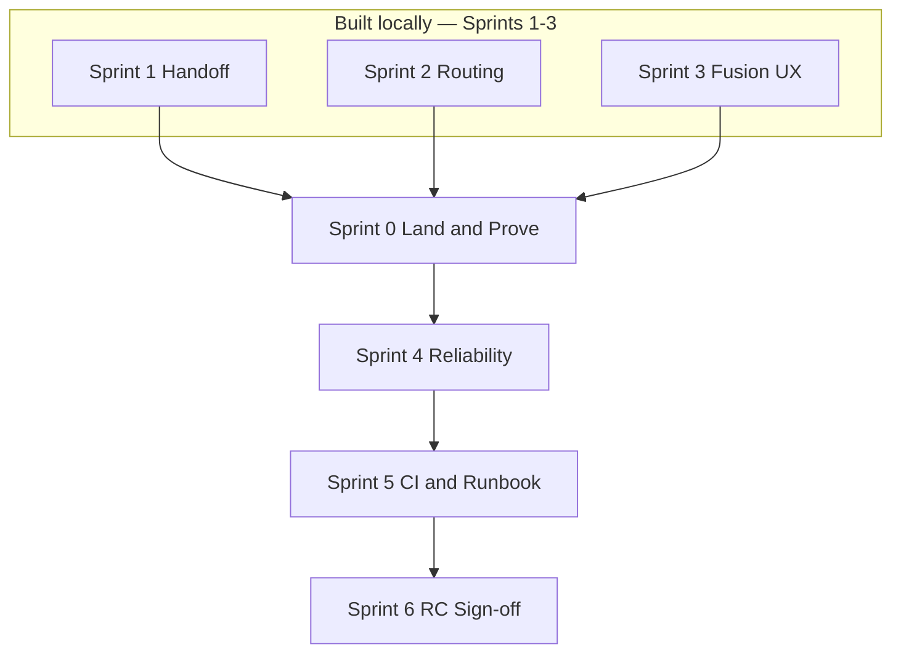

# Relay → Production Ready: Multi-Sprint Roadmap

> **North star:** A real team can clone `main`, run `relay chat` on a real repo, trust routing and handoffs, and pass a 15-item production checklist — without Pro LLM planner, cloud sync, or Harbor CI.
>
> **Today (2026-08-09):** ~82% feature-complete · ~72% production-ready · large uncommitted local worktree · full `pnpm test` green locally after V1/V2 verifier work.
>
> **Companion docs:** [sprint-plan-production-testing.md](./sprint-plan-production-testing.md) · [strategic-handoff-plan.md](./strategic-handoff-plan.md) · [thin-router.md](./thin-router.md)

---

## The journey in one picture

Think of production readiness as four layers stacked bottom-up. You cannot skip a layer.

```
┌─────────────────────────────────────────────────────────────┐
│  LAYER 4 — RELEASE          Sprint 6   RC tag + checklist   │
├─────────────────────────────────────────────────────────────┤
│  LAYER 3 — REPEATABILITY    Sprint 5   CI + runbook         │
├─────────────────────────────────────────────────────────────┤
│  LAYER 2 — TRUST            Sprint 4   Failures behave      │
├─────────────────────────────────────────────────────────────┤
│  LAYER 1 — TRUTH            Sprint 0   Land + prove it      │
└─────────────────────────────────────────────────────────────┘
         ▲ already built (Sprints 1–3) but not landed ▲
```

**Sprints 1–3 built the product.** Sprints 0 + 4–6 make it **production-ready**.

---

## Sprint map at a glance

| Sprint | Name | Duration | Status | One-line goal |
|--------|------|----------|--------|---------------|
| **1** | Strategic handoff | 1 week | ✅ **Code done** | Auth preflight, cost blend, tiered handoffs |
| **2** | Routing intelligence | 1 week | ✅ **Code done** | Hybrid router, trace, doctor, confidence filter |
| **3** | Fusion UX | 1 week | 🟡 **~85%** | Live E2E scaffold, footer, install, dash deprecated |
| **0** | Land & prove | 2–3 days | 🟡 **Partial** | Commit WIP, re-bench 3/3, tune priors |
| **4** | Reliability | 1 week | 🟡 **Partial** | Verify replan, graph verifier loop, loop detect |
| **5** | CI & runbook | 1 week | ⬜ Not started | GitHub Actions, baseline gates |
| **6** | Release candidate | 3–5 days | ⬜ Not started | 15/15 checklist, `v0.1.0-rc.1` |

**Remaining calendar:** ~3–4 weeks from today.

---

## Phase A — Foundation (Sprints 1–3) ✅ mostly done

These sprints are **implemented locally** but not fully **validated** or **on `main`**.

### Sprint 1 — Strategic handoff (Tracks A–D)

| Track | What | Status |
|-------|------|--------|
| A | Auth preflight — no Pi spawn when not authed | ✅ |
| B | Tiered handoffs + `maxHandoffTokens` | ✅ |
| C | Trivial goals → 1 step; `model_tier: capable` for review | ✅ |
| D | Cost blend, Pi `get_session_stats`, routing-stats `costUsd` | ✅ |

**Still to prove:** micro-bench Relay **3/3** after failover model fix; latency ≤ **1.5×** Claude.

### Sprint 2 — Routing intelligence

| ID | What | Status |
|----|------|--------|
| 2.1 | Hybrid 60/30/10 docs | ✅ |
| 2.2 | `step_routing.prefer` before failover | ✅ |
| 2.3 | `relay trace` audit trail + `--json` | ✅ |
| 2.4 | `compare-priors.sh` drift report | ✅ (priors not tuned) |
| 2.5 | `relay doctor --routing` expanded | ✅ |
| 2.6 | Confidence filter (<30% local success) | ✅ |
| 2.7 | Routing decision cache | ⬜ Optional — skip for RC |

**Still to prove:** 10 consecutive trivial runs, same harness, no failover.

### Sprint 3 — Fusion UX

| ID | What | Status |
|----|------|--------|
| 3.1 | Live E2E (`RELAY_LIVE_E2E=1`) | ✅ scaffold |
| 3.2 | Token/cost footer | ✅ |
| 3.3 | `relay dash` → `relay chat` | ✅ |
| 3.4 | MCP auto-wire on Pi spawn | ✅ |
| 3.5 | Pi session → RHP import | ⬜ Defer to post-RC |
| 3.6 | `relay install` | ✅ |
| 3.7 | Skills bridge | ✅ code; live assert optional |

**Still to prove:** `RELAY_LIVE_E2E=1` passes on dev machine with ≥1 real harness.

---

## Phase B — Truth (Sprint 0) 🎯 do next

**Objective:** Make the repo honest — everything built is on `main` and measured.

### Tasks

| ID | Task | Owner | Done when |
|----|------|-------|-----------|
| 0.1 | Review + commit ~98 files (Sprints 1–3) | All | `git status` clean on `main` |
| 0.2 | Commit benchmark artifacts + updated docs | Docs | `results-with-usage.jsonl` baseline in repo |
| 0.3 | Full test suite post-commit | QA | 404+ tests green |
| 0.4 | Re-run micro-bench with usage | Bench | Relay **3/3** pass |
| 0.5 | 10-run routing stability test | Routing | Same harness, no surprise failover |
| 0.6 | Seed `.relay/routing-stats.jsonl` + tune priors | Routing | `compare-priors.sh` drift < 0.15 |
| 0.7 | Document `doctor --routing` in quickstart | Docs | ✅ already done |

### Intelligence exit gates (Sprint 0)

| Gate | Target |
|------|--------|
| Pi auth failover | **0%** when Pi not authed |
| Trivial task steps | **1** step |
| Relay micro-bench | **3/3** pass |
| Latency (trivial) | ≤ **1.5×** direct Claude (~24s) |
| `routing-stats.jsonl` | Rows with `costUsd` after runs |

### Commands

```bash
pnpm build && pnpm test
bash jobs/mini-bench/host-micro/run-micro-bench-with-usage.sh
./jobs/mini-bench/compare-priors.sh
relay doctor --routing
relay harbor-exec "Create hello.sh printing hello" --agents claude-code,codex
```

**Duration:** 2–3 days.

---

## Phase C — Trust (Sprint 4)

**Objective:** Production means **predictable failure** — not silent success on exit code alone.

Routing intelligence is only trustworthy if failures are handled correctly.

### Tasks

| ID | Task | Files | Why |
|----|------|-------|-----|
| 4.1 | Replan on **verify failure** | `replan.ts`, `execute-plan.ts` | ✅ V1/V2 verify-fail retry loop with max retries |
| 4.2 | Durable resume: kill mid-run → `relay run --resume` | `runner.ts`, `runner-state.ts` | Ops requirement |
| 4.3 | Typed error taxonomy in events | `events.ts`, `routing-stats.ts` | 🟡 `verify_outcome` + `graph_node` present; broader timeout/capability taxonomy still open |
| 4.4 | Auto-detect test scripts in verify gate | `verify.ts` | ✅ existing test gate preserved; V1 moved deterministic step checks into `verifiers/` |
| 4.5 | Document human-in-the-loop (`manual` + `--advance`) | docs + test | Cursor steps |
| 4.6 | Loop detection: abort after >3 same-step retries | `execute-plan.ts` | ✅ repeated identical verifier evidence stops early; max retry budget enforced |
| 4.7 | Brownfield KPIs in `relay doctor --session` | `brownfield-kpi.ts`, `doctor.ts` | Session health |

### Exit criteria

- [ ] Kill orchestrator mid-run → resume completes same step
- [x] Verify-fail → replan or explicit `failed` with reason in trace
- [x] Loop detection stops runaway retry
- [ ] `relay doctor --session` shows KPIs when session active

**Duration:** 1 week.

---

## Phase D — Repeatability (Sprint 5)

**Objective:** Anyone cloning `main` gets the same green bar; routing regressions are caught automatically.

### Tasks

| ID | Task | Deliverable |
|----|------|-------------|
| 5.1 | GitHub Actions CI | `.github/workflows/ci.yml` |
| 5.2 | Mock fusion E2E in CI | `RELAY_MOCK_DRIVER=1` |
| 5.3 | Typecheck in CI | `pnpm build` |
| 5.4 | Baseline compare script | `compare-baseline.sh` — fail if latency >1.5× |
| 5.5 | Production testing runbook | `docs/production-testing-runbook.md` |
| 5.6 | Harbor smoke (manual, API keys) | Section in runbook — not CI-blocked |
| 5.7 | Document `trace --json` in runbook | Audit export for operators |
| 5.8 | Sample app fixture | `fixtures/sample-app/` for manual QA |

### Minimal CI workflow

```yaml
on: [push, pull_request]
jobs:
  test:
    runs-on: ubuntu-latest
    steps:
      - uses: actions/checkout@v4
      - uses: pnpm/action-setup@v4
      - uses: actions/setup-node@v4
        with: { node-version: 22, cache: pnpm }
      - run: pnpm install --frozen-lockfile
      - run: pnpm build
      - run: RELAY_MOCK_DRIVER=1 pnpm test
```

### Exit criteria

- [ ] CI green on every PR to `main`
- [ ] Runbook: install → init → chat → handoff → doctor → trace → benchmark
- [ ] New contributor passes runbook in <30 min

**Duration:** 1 week.

---

## Phase E — Release (Sprint 6)

**Objective:** Formal sign-off; tag **`v0.1.0-rc.1`**.

### Production checklist (15 items)

Run on a **clean clone** with Claude + Codex installed:

| # | Test | Pass |
|---|------|------|
| 1 | `pnpm install && pnpm build` | ☐ |
| 2 | `pnpm test` | ☐ |
| 3 | `relay init` in empty dir | ☐ |
| 4 | `relay doctor` — no errors | ☐ |
| 5 | `relay doctor --routing` — expected harnesses | ☐ |
| 6 | Trivial task: `relay harbor-exec "Create hello.sh…"` | ☐ |
| 7 | Multi-step: `relay chat` → test signal → 2+ steps | ☐ |
| 8 | Handoff: `relay handoff --to codex` → readable HANDOFF.md | ☐ |
| 9 | `relay trace` — hops + `failoverReason` | ☐ |
| 10 | `.relay/routing-stats.jsonl` has `costUsd` | ☐ |
| 11 | No Pi spawn when Pi not authed | ☐ |
| 12 | Trivial latency ≤ 1.5× direct Claude | ☐ |
| 13 | `RELAY_LIVE_E2E=1` test passes locally | ☐ |
| 14 | Kill + `relay run --resume` works | ☐ |
| 15 | No secrets in `events.jsonl` / logs | ☐ |

### Tasks

| ID | Task | Deliverable |
|----|------|-------------|
| 6.1 | Run checklist on macOS (+ Linux if possible) | `docs/production-testing-results.md` |
| 6.2 | Fix any failures | Patch release |
| 6.3 | Update quickstart with production path | `docs/quickstart.md` |
| 6.4 | Tag RC | `v0.1.0-rc.1` |
| 6.5 | Publish known limitations | `docs/known-limitations.md` |

### Known limitations (publish at RC)

- No Tier 3 LLM planner (`--smart` is Pro stub)
- No cloud session sync
- No Harbor Docker in CI
- No enterprise RBAC / OTel (Pro stubs)
- Pi session import into RHP partial (3.5 deferred)

**Duration:** 3–5 days.

---

## Intelligence readiness by sprint

How routing/planning maturity grows across sprints:

| Sprint | Intelligence milestone | Target % |
|--------|------------------------|----------|
| 1–2 (done) | Tier 1+2 built: preflight, blend, trace, doctor | ~72% built |
| **0** | **Proven:** 3/3 bench, priors tuned, stats seeded | ~75% trusted |
| **4** | **Trustworthy failures:** verify replan, typed errors | ~85% trusted |
| **5** | **Regression-gated:** CI catches routing breaks | ~90% trusted |
| **6** | **Signed off:** 15-item checklist pass | **~80% trusted at RC** |

Tier 3 LLM planner (Sprint 7+) is **explicitly out of scope** for RC.

---

## Dependency graph



**Critical path:** Sprint 0 → 4 → 5 → 6 (sequential).

---

## Parallel workstreams (optional)

If two people are available:

| Stream A | Stream B |
|----------|----------|
| Sprint 0 commit + bench | Sprint 4.4 verify gate + 4.6 loop detect |
| Sprint 4.1–4.3 replan/errors | Sprint 5.1–5.2 CI setup |
| Sprint 6 checklist execution | Sprint 5.5 runbook writing |

Do **not** parallelize Sprint 0 and Sprint 6 — validation must precede sign-off.

---

## Risk register

| Risk | Impact | Mitigation |
|------|--------|------------|
| Large uncommitted diff hides regressions | High | Sprint 0: full test + bench before more features |
| Relay micro-bench < 3/3 | High | Failover model fix landed; re-bench in Sprint 0 |
| Live E2E flaky | Medium | Env-gated; never block CI |
| Latency > 1.5× Claude | Medium | Accept for RC; optimize post-RC |
| Codex `exec` hangs | High | Timeout in drivers; document in runbook |
| No `routing-stats.jsonl` in prod use | Medium | Seed in Sprint 0; document in runbook |

---

## Weekly cadence

| Day | Activity |
|-----|----------|
| **Mon** | Sprint kickoff; update checkboxes in this doc |
| **Wed** | Demo: `relay chat` on `fixtures/sample-app` |
| **Fri** | Benchmark snapshot; merge to `main`; retro |

---

## Post-RC stretch (not required for production)

| Sprint+ | Theme | When |
|---------|-------|------|
| 7 | LLM planner (`--smart`) | Pro v0.2 |
| 8 | Sub-harness slash mesh | v0.3 |
| 9 | Governance plane (token budgets, MCP policy) | Enterprise |
| 10 | Cloud sessions | Mobile / remote |
| 11 | Harbor CI with secrets | Self-hosted runner |

---

## Quick start: what to do Monday

1. **Commit** all Sprint 1–3 WIP → `main`
2. **Re-run** micro-bench → target Relay 3/3
3. **Run** 10 trivial `harbor-exec` stability test
4. **Tune** `relay/routing-priors.yaml` from `compare-priors.sh`
5. **Kick off** Sprint 4 (verify replan)

---

*Last updated: 2026-07-21*
