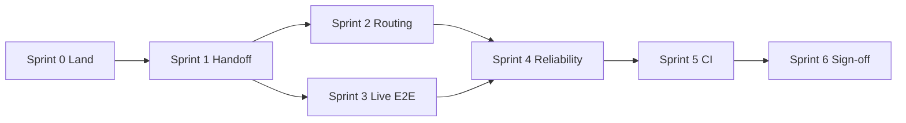

# Sprint Plan: Relay → Production Testing Ready

> **Goal:** Ship Relay to a state where a real team can run it on real repos, trust routing/handoffs, and validate behavior with automated + manual production-style tests — without claiming full enterprise governance or cloud/mobile yet.
>
> **Baseline:** ~72% complete (347 tests green; ~1,566 LOC strategic-handoff WIP uncommitted as of 2026-07-16).
>
> **Companion docs:** [strategic-handoff-plan.md](./strategic-handoff-plan.md) · [sprint-plan-pi-relay-fusion.md](./sprint-plan-pi-relay-fusion.md) · [benchmark-comparison.md](./benchmark-comparison.md)

---

## Definition of done: “production testing ready”

Relay is **production testing ready** when all of the following are true:

| Gate | Criteria |
|------|----------|
| **Stability** | `pnpm test` green in CI; no known P0 bugs in mesh loop |
| **Landable** | All routing/handoff WIP committed; reproducible from `main` |
| **Routing** | 0% Pi auth failover when Pi not authed; trivial goals → 1 step |
| **Performance** | Trivial micro-bench latency ≤ **1.5×** direct Claude (stretch: 1.2×) |
| **Cost visibility** | `costUsd` + tokens recorded for Claude, Codex, Pi on completed steps |
| **Handoffs** | Tiered bundles under token cap; `relay handoff` + auto-handoff verified |
| **Live proof** | At least one env-gated E2E with real harness CLI (not mock-only) |
| **Operability** | `relay doctor`, `relay trace`, testing runbook documented |
| **Security** | No secrets in `.relay/` or logs; auth preflight fail-closed |

**Out of scope for this plan (post-MVP):** LLM planner at scale, cloud session sync, MCP gateway, Harbor Docker with API keys in CI, enterprise RBAC.

---

## Sprint overview

| Sprint | Theme | Duration | Exit signal |
|--------|-------|----------|-------------|
| **0** | Land & baseline | 2–3 days | WIP on `main`; benchmark snapshot committed |
| **1** | Finish strategic handoff (A–D) | 1 week | 0% auth failover; cost blend live |
| **2** | Routing intelligence hardening | 1 week | Hybrid router stable; `doctor --routing` trustworthy |
| **3** | Fusion UX & live E2E | 1 week | One real CLI E2E; unified chat TUI |
| **4** | Reliability & verification | 1 week | Verify-fail replan; durable run-state |
| **5** | CI & production test harness | 1 week | GitHub Actions green; mini-bench in CI |
| **6** | Sign-off & release candidate | 3–5 days | Production testing checklist全部 pass |

**Total:** ~6–7 weeks to production testing ready.

---

## Sprint 0 — Land & baseline

**Objective:** Make the repo honest — everything built so far is on `main` and measurable.

### Tasks

| ID | Task | Owner area | Files / commands |
|----|------|------------|------------------|
| 0.1 | Review + commit strategic-handoff WIP (~36 files) | All | `harness-eligibility.ts`, `blended-router.ts`, `rhp-builder.ts`, `plan.ts`, `routing-stats.ts`, etc. |
| 0.2 | Commit docs + benchmark artifacts | Docs | `docs/strategic-handoff-plan.md`, `docs/benchmark-comparison.md`, `jobs/mini-bench/` |
| 0.3 | Run full test suite post-merge | QA | `pnpm build && pnpm test` |
| 0.4 | Capture baseline benchmark (with usage) | Bench | `bash jobs/mini-bench/host-micro/run-micro-bench-with-usage.sh` |
| 0.5 | Add `relay doctor --routing` smoke to quickstart | CLI | `packages/cli/src/commands/doctor.ts` |

### Exit criteria

- [ ] `git status` clean on `main` after merge
- [ ] 347+ tests pass
- [ ] `results-with-usage.jsonl` committed as baseline
- [ ] `relay doctor --routing` documents runnable harnesses

### Risks

- Large diff needs careful review (failover + router behavior)

---

## Sprint 1 — Finish strategic handoff (tracks A–D)

**Objective:** Complete the four parallel tracks from [strategic-handoff-plan.md](./strategic-handoff-plan.md). Tracks A–C are ~90% done; Track D needs router blend + Pi usage.

### Tasks

| ID | Task | Status today | Deliverable |
|----|------|--------------|-------------|
| 1.1 | **Track A:** execute-plan integration test “no Pi spawn when preflight fails” | Done | `execute-plan.integration.test.ts`, `process-prompt.integration.test.ts`, `routing-integration.test.ts` |
| 1.2 | **Track B:** verify `maxHandoffTokens` in all handoff paths (manual + auto) | Done | Test: review tier trims diff blobs |
| 1.3 | **Track C:** wire `model_tier: capable` for `review` steps | Not started | `plan.ts` → `model-router.ts` escalation |
| 1.4 | **Track D:** Pi RPC usage/token parsing | Not started | `packages/orchestrator/src/drivers/pi-rpc.ts` |
| 1.5 | **Track D:** median `costUsd` in `routing-stats-reader.ts` | Not started | Per `(taskType, harness)` aggregates |
| 1.6 | **Track D:** cost weight in `blended-router.ts` (`blend.cost: 0.15`) | Not started | After `min_local_samples` threshold |
| 1.7 | Re-benchmark after 1.1–1.6 | — | Update `docs/benchmark-comparison.md` |

### Success metrics (from strategic-handoff plan)

| Metric | Before | Sprint 1 target |
|--------|--------|-----------------|
| Pi auth failover rate | ~100% micro-bench | **0%** |
| Steps per trivial task | 1–3 + retry | **1** |
| Handoff size (trivial) | Full changed list | **< 2k tokens** |
| Relay latency (trivial) | ~63.5s avg | **≤ 1.5× Claude (~27s)** |

### Exit criteria

- [x] `relay harbor-exec "Create hello.sh printing hello"` — no Pi in trace when Pi not authed
- [ ] `routing-stats.jsonl` rows include `costUsd` for Claude, Codex, Pi
- [ ] Blended router uses cost signal when ≥5 local samples
- [ ] Review steps request capable model tier when policy says so

---

## Sprint 2 — Routing intelligence hardening

**Objective:** Move routing from ~6/10 to ~8/10 — reliable hybrid tier-1/tier-2 without LLM planner yet.

### Tasks

| ID | Task | Deliverable |
|----|------|-------------|
| 2.1 | Document hybrid routing tiers in `docs/thin-router.md` | 60% rules / 30% blend / 10% reserved for LLM |
| 2.2 | Harden `step_routing.prefer` precedence over global failover | `plan.ts`, `blended-router.ts` tests |
| 2.3 | `failoverReason` surfaced in `relay trace` output | `packages/cli/src/commands/trace.ts` |
| 2.4 | Routing priors: validate `relay/routing-priors.yaml` against micro-bench | Tune weights per task type |
| 2.5 | `relay doctor --routing` expanded: show blend weights, local sample counts, last 5 outcomes | Operator visibility |
| 2.6 | Confidence threshold: skip harness with <0.3 local success rate (after min samples) | `blended-router.ts` |
| 2.7 | Cache routing decision for identical goal+step (optional, dev flag) | Reduce duplicate LLM/router work |

### Exit criteria

- [ ] 10 consecutive trivial runs: same harness chosen, no failover
- [ ] `relay trace` shows `failoverReason` for every hop
- [ ] `doctor --routing` is the first debug step in runbook
- [ ] Documented routing decision tree in `docs/thin-router.md`

---

## Sprint 3 — Fusion UX & live E2E

**Objective:** Prove the Pi × Relay fusion path with real CLIs; remove dual-UX confusion.

### Tasks

| ID | Task | Status today | Deliverable |
|----|------|--------------|-------------|
| 3.1 | Live-harness E2E behind `RELAY_LIVE_E2E=1` | Mock only | `fixtures/minimal-relay/e2e/live-fusion.test.ts` |
| 3.2 | Token footer: populate from driver usage events | Partial | `packages/cli/src/tui/footer.ts` |
| 3.3 | Deprecate `relay dash` → redirect to `relay chat` | Dual REPL | `run-dash.ts` prints deprecation + alias |
| 3.4 | Auto-wire `relay mcp install` when Pi spawns (if `relay/mcp.json` exists) | Partial | `execute-plan.ts`, `pi-rpc.ts` |
| 3.5 | Post-run: import Pi session summary into RHP events | Not started | `post-run.ts` |
| 3.6 | `relay install` — check PATH for claude, codex, cursor, pi; print fix hints | Not started | `packages/cli/src/commands/install.ts` |
| 3.7 | Skills bridge: verify `relay/skills/*.md` loaded in live Pi run | Done (code) | Live E2E assertion |

### Live E2E spec (minimum)

```bash
# Skip in CI by default; run locally before release
RELAY_LIVE_E2E=1 pnpm test -- fixtures/minimal-relay/e2e/live-fusion.test.ts
```

Test flow:
1. `relay session start "create hello.sh"`
2. `relay chat` or `harbor-exec` with **one** installed harness (detect at runtime)
3. Assert file exists + `events.jsonl` has `harness_complete`
4. Assert handoff bundle if multi-step

### Exit criteria

- [ ] Live E2E passes on dev machine with ≥1 real harness
- [ ] CI runs mock E2E only (live skipped, not failed)
- [ ] `relay dash` deprecated message shown
- [ ] Footer shows token count after implement step
- [ ] `relay install` lists missing binaries

---

## Sprint 4 — Reliability & verification

**Objective:** Production testing needs predictable failure behavior, not silent success on exit-code alone.

### Tasks

| ID | Task | Deliverable |
|----|------|-------------|
| 4.1 | Replan on **verify failure** (not just harness exit code) | `replan.ts`, `execute-plan.ts` |
| 4.2 | Durable `run-state.json` resume: crash mid-wave → `relay run --resume` | `packages/orchestrator/src/runner.ts` |
| 4.3 | Typed error taxonomy in events: `auth`, `timeout`, `verify`, `capability` | `packages/orchestrator/src/events.ts` |
| 4.4 | Test gate: auto-detect `package.json` scripts (`test`, `vitest`, `pytest`) | `verify.ts` |
| 4.5 | Human-in-the-loop step: `manual` status + `relay run --advance` | Already partial — document + test |
| 4.6 | Loop detection: abort if same step retried >3 times | `execute-plan.ts` (align with gateway pattern from research) |
| 4.7 | Brownfield KPI gate in `relay doctor` for active session | `brownfield-kpi.ts` → doctor output |

### Exit criteria

- [ ] Kill orchestrator mid-run → resume completes same step
- [ ] Verify-fail triggers replan or explicit `failed` with reason
- [ ] Loop detection stops runaway retry
- [ ] `relay doctor` shows session KPIs when session active

---

## Sprint 5 — CI & production test harness

**Objective:** Anyone cloning `main` gets the same green bar; benchmarks regression-gated.

### Tasks

| ID | Task | Deliverable |
|----|------|-------------|
| 5.1 | GitHub Actions: `pnpm install`, `pnpm build`, `pnpm test` | `.github/workflows/ci.yml` |
| 5.2 | CI: mock fusion E2E only | `RELAY_MOCK_DRIVER=1` in workflow |
| 5.3 | CI: lint/typecheck if configured | Optional `pnpm lint` |
| 5.4 | Mini-bench script: `--baseline-compare` fails if latency >1.5× | `jobs/mini-bench/host-micro/compare-baseline.sh` |
| 5.5 | Production testing runbook | `docs/production-testing-runbook.md` |
| 5.6 | Harbor smoke doc (manual, API keys) | Section in runbook — not CI-blocked |
| 5.7 | `relay trace --json` for machine-readable audit | CLI flag |
| 5.8 | Sample app fixture: `fixtures/sample-app/` thrift or todo scenario | Manual QA target |

### CI workflow (minimal)

```yaml
# .github/workflows/ci.yml
on: [push, pull_request]
jobs:
  test:
    runs-on: ubuntu-latest
    steps:
      - uses: actions/checkout@v4
      - uses: pnpm/action-setup@v4
      - uses: actions/setup-node@v4
        with: { node-version: 22, cache: pnpm }
      - run: pnpm install --frozen-lockfile
      - run: pnpm build
      - run: RELAY_MOCK_DRIVER=1 pnpm test
```

### Exit criteria

- [ ] CI green on every PR to `main`
- [ ] Runbook covers: install, init, chat, handoff, doctor, trace, benchmark
- [ ] Baseline compare script documented
- [ ] New contributor can pass runbook in <30 min

---

## Sprint 6 — Sign-off & release candidate

**Objective:** Formal production testing checklist; tag `v0.1.0-rc.1` (or similar).

### Production testing checklist

Run on a **clean machine** (or fresh clone) with Claude + Codex installed:

| # | Test | Command / action | Pass |
|---|------|------------------|------|
| 1 | Build | `pnpm install && pnpm build` | ☐ |
| 2 | Unit tests | `pnpm test` | ☐ |
| 3 | Init project | `relay init` in empty dir | ☐ |
| 4 | Doctor | `relay doctor` — no errors | ☐ |
| 5 | Routing doctor | `relay doctor --routing` — expected harnesses | ☐ |
| 6 | Trivial task | `relay harbor-exec "Create hello.sh printing hello"` | ☐ |
| 7 | Multi-step | `relay chat` → goal with test signal → 2+ steps | ☐ |
| 8 | Handoff | `relay handoff --to codex` → HANDOFF.md readable | ☐ |
| 9 | Trace | `relay trace` shows hops + failoverReason | ☐ |
| 10 | Cost stats | `.relay/routing-stats.jsonl` has costUsd | ☐ |
| 11 | No auth failover | No Pi spawn when Pi not authed | ☐ |
| 12 | Latency | Trivial task ≤1.5× direct Claude | ☐ |
| 13 | Live E2E | `RELAY_LIVE_E2E=1` test passes locally | ☐ |
| 14 | Resume | Kill + `relay run --resume` works | ☐ |
| 15 | Secrets | No tokens in `events.jsonl` / logs | ☐ |

### Tasks

| ID | Task | Deliverable |
|----|------|-------------|
| 6.1 | Execute full checklist on 2 machines (macOS + Linux if possible) | Signed results in `docs/production-testing-results.md` |
| 6.2 | Fix any checklist failures | Patch release |
| 6.3 | Update `docs/quickstart.md` with production-testing path | Docs |
| 6.4 | Tag release candidate | `v0.1.0-rc.1` |
| 6.5 | Known limitations doc | `docs/known-limitations.md` |

### Exit criteria

- [ ] 15/15 checklist items pass on primary dev machine
- [ ] ≥13/15 on secondary machine (document skips)
- [ ] RC tag pushed
- [ ] Known limitations published (no LLM planner, no cloud, no Harbor CI)

---

## Stretch goals (post production-testing-ready)

These improve routing to **10/10** and enterprise readiness but are **not required** for the RC above.

| Sprint+ | Theme | Key deliverables |
|---------|-------|------------------|
| **7** | LLM planner (tier-3 router) | `planner.ts` implements `refinePlanWithLlm`; `--smart` Pro gate |
| **8** | Sub-harness mesh | Slash commands spawn child harness per subtask |
| **9** | Governance plane | Per-workflow token budgets, MCP tool policy |
| **10** | Cloud sessions | `relay cloud push/pull`, HTTP worker for mobile Codex |
| **11** | Harbor CI | Docker benchmarks with injected secrets (self-hosted runner) |

---

## Dependency graph



Sprints 2 and 3 can run **in parallel** after Sprint 1 if two contributors are available.

---

## Risk register

| Risk | Impact | Mitigation |
|------|--------|------------|
| Large uncommitted diff has hidden regressions | High | Sprint 0: full test + benchmark before feature work |
| Live E2E flaky (CLI auth, network) | Medium | Env-gated; never block CI |
| Latency target missed | Medium | 1.5× acceptable for RC; 1.2× stretch in Sprint 1 |
| Codex `exec` hangs (seen: 5h) | High | Timeout wrapper in drivers; document in runbook |
| Harbor Docker needs API keys | Low | Manual smoke only; out of CI scope |
| Dual TUI confuses testers | Medium | Sprint 3 deprecation |

---

## File map (primary touch points by sprint)

| Sprint | Packages / paths |
|--------|------------------|
| 0 | All uncommitted WIP, `jobs/mini-bench/` |
| 1 | `blended-router.ts`, `routing-stats-reader.ts`, `pi-rpc.ts`, `model-router.ts`, `plan.ts` |
| 2 | `thin-router.ts`, `doctor.ts`, `trace.ts`, `docs/thin-router.md` |
| 3 | `relay-tui.ts`, `run-dash.ts`, `footer.ts`, `e2e/live-fusion.test.ts`, `install.ts` |
| 4 | `replan.ts`, `runner.ts`, `verify.ts`, `execute-plan.ts`, `brownfield-kpi.ts` |
| 5 | `.github/workflows/ci.yml`, `docs/production-testing-runbook.md` |
| 6 | `docs/quickstart.md`, `docs/known-limitations.md`, git tag |

---

## Weekly cadence (recommended)

| Day | Activity |
|-----|----------|
| Mon | Sprint kickoff; pick tasks; update this doc checkboxes |
| Wed | Mid-sprint demo: `relay chat` on sample-app |
| Fri | Benchmark snapshot; merge to `main`; retrospective |

---

## Quick reference: what’s done vs what this plan builds

| Already complete (~72%) | This plan finishes |
|-------------------------|-------------------|
| RHP sessions + handoff protocol | Commit + harden WIP |
| 4 harness adapters + build | `relay install` |
| Pi RPC + TUI + event bus | Live E2E, footer tokens |
| Blended router (local) | Cost blend + doctor/trace |
| Tracks A–C (local) | Track D + model_tier |
| 347 unit tests | CI + production checklist |
| Mock fusion E2E | Resume, verify replan, loop detect |

---

*Last updated: 2026-07-16*
