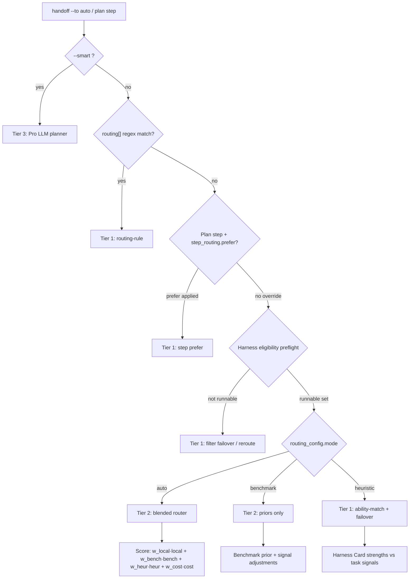

# Thin Router

Relay's **Thin Router** picks the next harness for `relay handoff --to auto` and plan steps using a **hybrid 60/30/10** architecture — mostly deterministic policy, blended scoring when needed, LLM planning reserved for Pro.

## Hybrid routing architecture

| Tier | Share | Mechanism | LLM? |
|------|-------|-----------|------|
| **Tier 1** | ~60% | Regex rules, `step_routing.prefer`, harness eligibility preflight | No |
| **Tier 2** | ~30% | Blended router (local + benchmark + heuristic + cost) | No |
| **Tier 3** | ~10% | Pro LLM planner (`--smart`) | Yes |

The percentages are a **design target** for where routing decisions should originate — not a runtime quota. Most handoffs and plan steps resolve on Tier 1 or Tier 2 without an LLM call.

### Decision tree



### When each tier applies

**Tier 1 — deterministic policy (~60%)**

- **`routing[]` regex rules** in [`relay/session-policy.yaml`](../relay/session-policy.yaml) — first pattern match wins; always checked before blended selection.
- **`step_routing.prefer`** — per step type (`implement`, `test`, `review`, `debug`); applied after blended/heuristic scoring when building a plan (`plan.ts`). First preferred harness in the global `failover` list wins.
- **Harness eligibility preflight** — `filterRunnableHarnesses` / `isHarnessRunnable` drop harnesses that fail install or auth checks (e.g. Pi without authed provider) **before** spawn; failover order is filtered at plan time and execute time.

Reasons returned: `routing-rule`, `ability-match`, `failover` (includes step-prefer override).

**Tier 2 — blended scoring (~30%)**

- Used when `routing_config.mode: auto` (default) and no Tier 1 regex override applies.
- Combines four signals from [`relay/routing-priors.yaml`](../relay/routing-priors.yaml), `.relay/routing-stats.jsonl`, Harness Cards, and local cost medians.
- Tie-breaks use `failover` order; zero-score cases fall back to first failover entry.

Reason returned: `blended` (with per-signal breakdown).

**Tier 3 — Pro LLM planner (~10%, reserved)**

- `relay handoff --to auto --smart` — deferred; LLM-assisted routing for ambiguous goals, cross-cutting refactors, or when Tier 1+2 confidence is low.
- OSS path never calls an LLM for routing.

## OSS vs Pro

| Mode | Command | Tier |
|------|---------|------|
| OSS | `relay handoff --to auto` | Tier 1 + Tier 2 |
| Pro | `relay handoff --to auto --smart` | Tier 3 (planned) |

## Configuration files

| File | Purpose |
|------|---------|
| [`relay/registry.yaml`](../relay/registry.yaml) | Harness Cards (`strengths`, `weaknesses`, `binaries`) |
| [`relay/session-policy.yaml`](../relay/session-policy.yaml) | `routing[]`, `failover`, `step_routing`, `routing_config`, governance |
| [`relay/routing-priors.yaml`](../relay/routing-priors.yaml) | Benchmark success rates + `signal_adjustments` (optional) |
| `.relay/routing-stats.jsonl` | Local routing outcomes from past runs (optional) |

### Example policy snippets

From [`relay/session-policy.yaml`](../relay/session-policy.yaml):

```yaml
routing: []   # regex overrides — Tier 1

routing_config:
  mode: auto
  min_local_samples: 5
  blend:
    local: 0.425
    benchmark: 0.2125
    heuristic: 0.2125
    cost: 0.15

step_routing:          # Tier 1 per-step prefer
  implement:
    prefer: [claude-code, codex, pi]
  test:
    prefer: [codex, claude-code]
  review:
    prefer: [claude-code]
    model_tier: capable
  debug:
    prefer: [codex, pi]

failover: [pi, cursor, claude-code, codex]
```

Priors live in [`relay/routing-priors.yaml`](../relay/routing-priors.yaml) — task-type × harness/model success rates used by Tier 2 benchmark signal.

## Blended routing (Tier 2)

When `routing_config.mode` is `auto`, the blended router scores each candidate harness:

| Signal | Source | What it measures |
|--------|--------|------------------|
| **Local** | `.relay/routing-stats.jsonl` | Project success rate per (taskType, harness) after `min_local_samples` |
| **Benchmark** | `relay/routing-priors.yaml` | Curated priors + `signal_adjustments` |
| **Heuristic** | Harness Card strengths | Ability match vs detected task signals |
| **Cost** | `.relay/routing-stats.jsonl` | Median `costUsd` per successful step (lower cost → higher score) |

Formula (see `blended-router.ts`):

```
score = w_local·local + w_benchmark·bench + w_heuristic·heur + w_cost·cost
```

Weights redistribute when local or cost data is missing (`effectiveBlendWeights`). Explicit `routing[]` rules **always win** — checked before Tier 2.

Other modes:

- `heuristic` — Tier 1 ability match + failover only (legacy ThinRouter)
- `benchmark` — priors only; falls back to failover when priors are missing

Example auto handoff output:

```
Auto-routed to: cursor
Reason: blended (local:0.82 bench:0.79 heur:0.71 cost:0.65)
Handoff prepared for: cursor
```

### Inspecting routing

```bash
relay doctor --routing
```

Prints `routing_config`, priors summary, local stats, and a route preview for the active session goal.

## Session policy governance

Optional `governance` block in `session-policy.yaml`:

```yaml
governance:
  requireGitSnapshotOnHandoff: true
  maxHandoffTokens: 8000
  maxTranscriptLines: 200
```

## Fixture examples

From `fixtures/minimal-relay/relay/session-policy.yaml`:

| Goal | Harness | Tier / Reason |
|------|---------|---------------|
| `fix React component` | `cursor` | Tier 2 `blended` — frontend signal + fix priors |
| `write unit tests` | `codex` | Tier 2 `blended` — test signal + test priors |
| `refactor module layout` | `claude-code` | Tier 2 `blended` — refactor signal + ability match |
| `build cli tool` | `pi` | Tier 2 `blended` or Tier 1 `failover` |
| Regex override (if configured) | matched harness | Tier 1 `routing-rule` |

## CLI usage

```bash
cd fixtures/minimal-relay
relay session start "fix React component"
relay handoff --to auto
```

Example output:

```
Auto-routed to: cursor
Reason: blended (local:0.00 bench:0.83 heur:1.00)
Handoff prepared for: cursor
Session: <session-id>
Handoff #1
Files:
  .relay/sessions/<session-id>/HANDOFF.md
  .relay/sessions/<session-id>/handoff.json
```

## Related

- RouterBench → Relay mapping: [`docs/research/routerbench-audit-notes.md`](research/routerbench-audit-notes.md)
- Strategic handoff plan: [`docs/strategic-handoff-plan.md`](strategic-handoff-plan.md)
